🇬🇧 [English](README.md) · 🇩🇪 **Deutsch** · 🇪🇸 [Español](README.es.md) · 🇫🇷 [Français](README.fr.md) · 🇷🇺 [Русский](README.ru.md) · 🇨🇳 [中文](README.zh.md) · 🇹🇼 [繁體中文](README.zh-TW.md) · 🇧🇷 [Português (Brasil)](README.pt.md) · 🇯🇵 [日本語](README.ja.md) · 🇰🇷 [한국어](README.ko.md)

# Aion DPS – Daevas Power Suite

**Die kostenlose Open-Source-Companion-App für AION 2** — Live-Schaden und -Heilung für deine ganze Gruppe, ein durchklickbares Overlay, Boss-Ranglisten, eine Karte für Pets und Sammelpunkte, ein Event-Zeitplan und Weltboss-Timer. Für Windows, Open Source, und er liest nie den Spielspeicher.

<p align="center">
  <a href="../../releases/latest"><b>⬇ Für Windows herunterladen</b></a> · <a href="https://aiondps.com">Webseite</a> · <a href="https://aiondps.com/features">Alle Funktionen</a> · <a href="https://aiondps.com/instances">Boss-Ranglisten</a>
  <br><a href="https://aiondps.com">aiondps.com</a> · <a href="https://daevasuite.com">daevasuite.com</a> · <a href="https://daevaspowersuite.com">daevaspowersuite.com</a>
</p>

<p align="center">
  <a href="../../releases/latest"></a>
  <a href="../../releases"></a>
  <a href="LICENSE"></a>
  <a href="../../actions/workflows/ci.yml"></a>
  
</p>

<p align="center">
  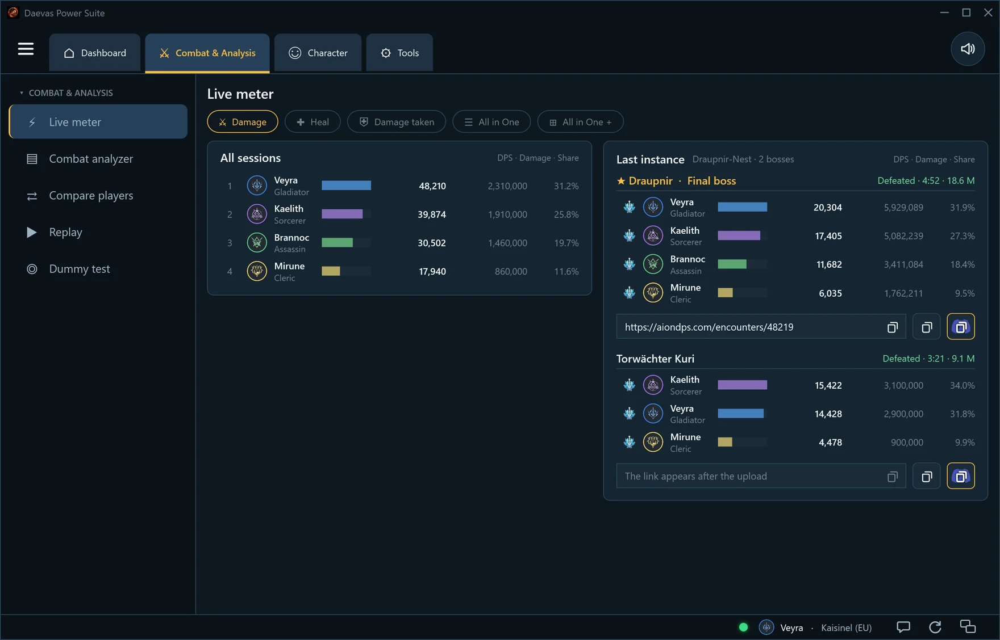
  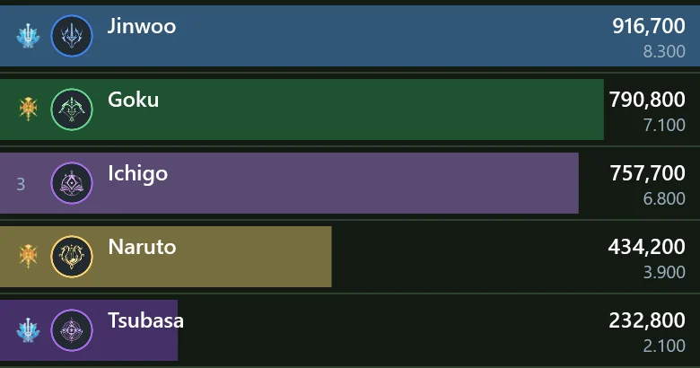
</p>

> Die Namen, Spieler und Zahlen in den folgenden Bildern sind Demodaten.

## Warum dieser Meter

- Live-DPS, iDPS und HPS für jeden Spieler in deiner Gruppe oder deinem Raid
- Ein durchklickbares Overlay, das keinen Klick abfängt
- Skill-Aufschlüsselung mit Krit-Raten und DPS-Kurve
- Boss-Ranglisten und öffentliche Charakterprofile auf aiondps.com (Upload optional, standardmäßig aus)
- Interaktive Karte, Event-Zeitplan, Weltboss-Timer und ein Netzwerk-Overlay
- Boss-Casts per Sprachausgabe angesagt, ein Beute-Log, ein Attribute-Tool, ein Crafting-Rechner und eine tägliche Checkliste
- Passiv: nur Paketmitschnitt, kein Speicherlesen, keine Code-Injektion, keine Spieldaten ans Spiel gesendet
- Kostenlos, Open Source (MIT) und aktualisiert sich selbst

Funktioniert mit der globalen Version von AION 2 — allen Regionen, die NCSOFT am 5. Oktober 2026 gestartet hat. Korea und Taiwan sind einige Versionen voraus, dort kann die Skill-Erkennung unvollständig sein.

Ein Schaden-/Heilungs-Meter und Werkzeugkasten für **Aion 2**. Es liest den Netzwerkverkehr des Spiels auf deinem Rechner
über den [Npcap](https://npcap.com)-Treiber — passiv: Es sendet keine Spieldaten und fasst weder den
Spielprozess noch dessen Speicher an. Das Einzige, was es in Richtung Spielserver schicken kann, ist ein kleiner Ping, und nur, wenn du das Netzwerk-Overlay oder die Netzwerkseite selbst einschaltest (siehe [Netzwerk-Overlay](#netzwerk-overlay)). Nichts von deinem Spiel verlässt deinen Rechner, es sei denn, du lädst es hoch (siehe
[Uploads](#uploads)); das Einzige, was sonst gesendet wird, ist die Update-Prüfung, die GitHub fragt, ob eine neuere
Version existiert, und die sich abschalten lässt; siehe [Updates](#updates).


## Inhalt

[Installation](#installation) · [Was es kann](#was-es-kann) · [Benutzung](#benutzung) · [Tastenkürzel](#tastenkürzel) ·
[Uploads](#uploads) · [Updates](#updates) · [Sprachen](#sprachen) · [Aus dem Quellcode bauen](#aus-dem-quellcode-bauen)

## Installation

1. Installiere den [Npcap](https://npcap.com)-Treiber (der Meter braucht ihn, um den Verkehr des Spiels zu sehen;
   er gehört nicht zum Installer).
2. Lade `AionDpsMeter-win-Setup.exe` vom [neuesten Release](../../releases/latest) herunter und führe sie aus.
   Sie installiert in dein Benutzerprofil und startet den Meter — keine Administratorrechte, kein .NET nötig.
3. Starte den Meter und logge dich dann mit deinem Charakter ein. Der Meter liest Charakter, Ausrüstung, Skills und
   Daevanion-Boards aus dem Spiel selbst; der Server, auf dem du spielst, wird automatisch erkannt.

## Was es kann

### Die 2.0-Oberfläche: Dashboard, Widgets und Overlay-Designer

Das Programm öffnet sich als ein Fenster mit den Reitern **Dashboard**, **Kampf & Analyse** und **Charakter**; die Tools sind unter **Tools** gruppiert (Welt, Kampf & Streaming und **Client** für die Einstellungen des Programms selbst). Planung (Checkliste, Attribute, Stat-Rechner) liegt im Reiter Charakter. Jede Tool-Seite hat einen Reiter **Darstellung** und einen Reiter **Konfiguration**. Das **Dashboard** ist ein Board, das du selbst anordnest: Verschiebe ein Widget an seinem Titel, ändere die Größe an der Ecke, nimm es mit dem Kreuz weg und hol es mit dem Plus zurück; die Checkliste, Weltbosse, Kennzahlen, der letzte Bosskampf, Update, Ankündigungen und Twitch Drops sind Widgets, und jede Seite der App kann eines werden. Du kannst mehrere Dashboards führen. Jedes Widget kann auch als Overlay über dem Spiel stehen.

Drücke **Ctrl+Alt+D**, um den **Overlay-Designer** zu öffnen: Er dunkelt den Bildschirm ab und lässt dich jedes Overlay und jedes Widget ziehen, skalieren und andocken (Schalter für Raster und Andocken in seiner Leiste); ein Zahnrad an jedem Overlay öffnet dessen Hintergrundfarbe, Hintergrund-Deckkraft und Text-Deckkraft. **Esc** verlässt ihn.

### Live-Schaden und Heilung für alle

Jeder Spieler in deiner Gruppe oder deinem Raid mit Name, Gesamtschaden, DPS und Anteilsbalken; Fraktion und Klasse
werden als Icons angezeigt. Filtere nach Klasse, Gruppe oder Ziel. Der **Mob/Boss**-Filter schaltet zwischen Gesamt-DPS und
echtem **iDPS** pro Ziel um; Bosse werden aus den Daten des Spiels erkannt und mit Namen angezeigt. Ein
**PvE/PvP**-Schalter trennt die beiden, und ein Wipe an einem Boss bekommt einen eigenen Eintrag (ein Totenkopf markiert einen Versuch,
nach dem der Boss wieder volle Lebenspunkte hatte).

### Fünf Ansichten, ein Klick entfernt

**Schaden**, **Heilung**, **Erlittener Schaden** und zwei **All in One**-Ansichten. Umschalten mit den Modus-Chips
auf der Live-Meter-Seite (und auf dem Meter-Widget, solange der Overlay-Designer offen ist). *All in One* zeigt erlittenen Schaden,
Heilung und Gesamt nebeneinander, *All in One Compact* behält die gewohnten Spalten DPS und Gesamt und setzt
Heilung und erlittenen Schaden in eine kleine zweite Zeile unter den Namen.

<p align="center">
  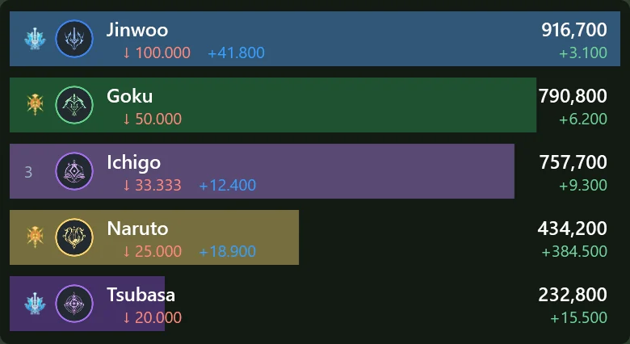
  
</p>

### Ein durchklickbares Overlay

Das Live-Meter-Widget liegt als kleine Chips (oder kompakte Liste) über Aion 2, ohne
auch nur einen Klick abzufangen. Deckkraft, Schadensanteil-Balken, die Lebenspunkte des Bosses und der erlittene Schaden pro Spieler
sind Optionen. Das kompakte Panel kann optional Mausklicks zum Spiel durchlassen. Das Overlay zeichnet nur, solange das Spiel im Vordergrund ist. Zeige die Overlays und blende das Fenster von überall mit **Ctrl+Alt+H** aus.

Optional (**Tools → Client → Allgemein**, bei Spielmenüs ausblenden, standardmäßig aus): Der Meter und seine Overlays machen Platz, solange eines der Spielmenüs offen ist (Karte, Inventar, Legion, Shop, Esc ...), und kommen zurück, wenn du es schließt. Erkannt wird das am Mauszeiger: Im Steuerungsmodus, der den Cursor beim Spielen versteckt, zeigt das Spiel ihn, sobald ein Menü aufgeht; hältst du die Taste zum Anzeigen des Cursors (standardmäßig Alt), bleibt der Meter sichtbar, damit du ihn anklicken kannst, und das Overlay-Tastenkürzel zeigt die Overlays für das gerade offene Menü. Im klassischen Steuerungsmodus ist der Cursor immer sichtbar, deshalb lassen sich Menüs nicht unterscheiden; der Meter bemerkt das im Kampf und bleibt dann einfach sichtbar.

### Skill-Aufschlüsselung für jeden Spieler

**Doppelklick** auf einen Spieler: jeder Skill mit Treffern, Crit-Rate, Summe, Min, Max und Durchschnitt, aufgeteilt nach Ziel,
dazu eine DPS-Kurve über den gesamten Kampf. Crit-Raten werden direkt aus den Trefferdaten des Servers gelesen und sind daher exakt. Die Tabelle zeigt außerdem, wie die Treffer einer Fertigkeit gelandet sind: **Rücken**, **Front**, **Perfekt**, **Doppelt** und **Multi** (mehrere Schläge in einem Treffer) als Anteil ihrer direkten Treffer, gelesen aus den Trefferdaten. Doppelt (etwa der doppelte Schaden), Perfekt (ein kleiner Bonus) und Parade wurden anhand des Schadens geprüft, den sie verursachen; Rücken und Front stammen aus einem Richtungsbyte, das noch nicht gegen das Spiel geprüft wurde, und das Fenster weist darauf hin.

<p align="center">
  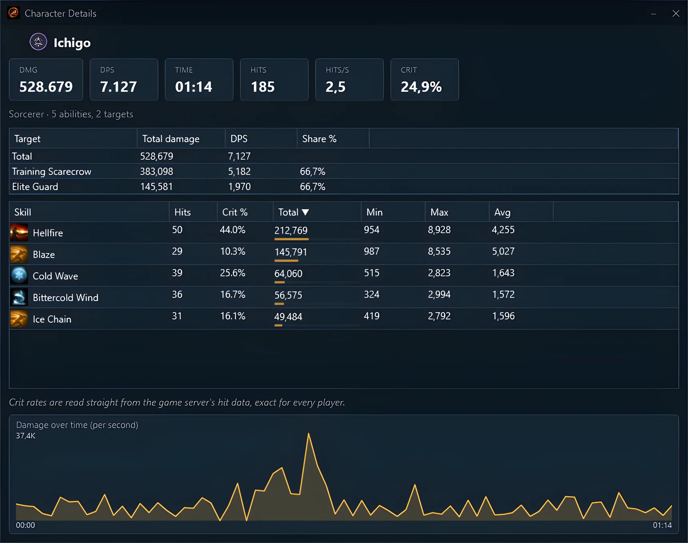
</p>

### Rotation, Effekte und Stagger

Dasselbe Fenster hat zwei weitere Tabs. **Rotation** zeichnet jeden Skill, den der Spieler benutzt hat, im Moment der Benutzung auf eine Zeitleiste: Unterstützungsskills in der oberen Spur, Schadensskills darunter, ein direkt nach einem anderen eingeflochtener Skill eine Zeile tiefer, sodass eine Folge von Einflechtungen wie eine Treppe aussieht. Dahinter läuft der DPS des Spielers (der Durchschnitt der letzten fünf Sekunden) und die Momente, in denen ein Monster gestaggert war. Zieh, um dich durch den Kampf zu bewegen, **Strg + Mausrad** zoomt, und beim Überfahren eines Symbols siehst du den Einsatz (wann, der wievielte von wie vielen, die Zeit seit dem vorherigen, der DPS zu diesem Zeitpunkt). Darunter stehen der **Opener** (die ersten Skills in Reihenfolge) und die *Rotation in Kürze*: Einsätze, Pro Min., Abstand zwischen zwei Einsätzen, Erster Einsatz und der Anteil am Schaden. **Buffs** listet jeden Effekt auf, der auf dem Spieler lag, mit seiner Laufzeit, dem Teil davon, der vom Spieler selbst stammte, wie oft er aufgelegt wurde und wer ihn gegeben hat - ein Effekt, den zwei Spieler gleichzeitig aufrechterhalten haben, zählt nur einmal.

Sessions, die mit den Rotationsdaten in eine Datei gespeichert wurden (siehe Sessions), zeigen sie nach dem Laden wieder.

<p align="center">
  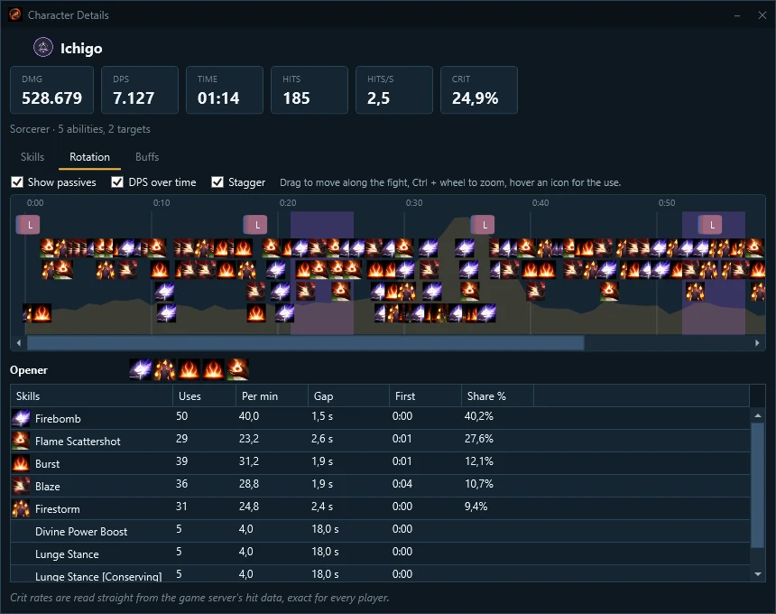
</p>

### Replay eines Boss-Kampfs (früher Test)

Im Spielerfenster eines Boss-Kampfs spielt **Replay** den Kampf von oben ab: Deine Gruppe als klassenfarbige Punkte mit den letzten Sekunden ihres Wegs, der Boss mit seiner Blickrichtung und seiner Gesundheit, die Flächen der Skills, die er gerade aufbaut (bernsteinfarben beim Aufbau, rot beim Auftreffen – gestrichelt, solange die Größe noch geraten ist), ein roter Ring um jeden, den er getroffen hat, die Toten durchgestrichen. Unter der Karte zeigt eine Zeitleiste die großen Angriffe des Bosses (bernstein), die Treffer auf die Gruppe (rot), Tode, Stagger (schattiert) und die Gesundheit des Bosses; per Klick oder Ziehen springst Du zu diesem Moment. Abspielen und Pause (Leertaste), Geschwindigkeiten von halb bis vierfach, ← und → springen fünf Sekunden, Karte ziehen, Mausrad zum Zoomen, Doppelklick zum erneuten Einpassen.

Die Positionen sind die eigenen Messwerte des Spiels: Es sendet sie mit Bewegungen und Skills, nicht in regelmäßigem Takt, deshalb wird ein Weg gerade zwischen zwei Positionen gezeichnet. Das Spiel sagt nie, wie groß die Fläche eines Angriffs ist: Der Meter lernt die Größe jedes Skills daraus, wen er getroffen hat, und merkt sie sich über Kämpfe hinweg. Gezeigt werden nur Deine Gruppe und die Bosse, nie andere Spieler. Ein Kampf behält sein Replay im lokalen Verlauf; Kämpfe, die mit einer älteren Version aufgezeichnet wurden, haben keines.

<p align="center">
  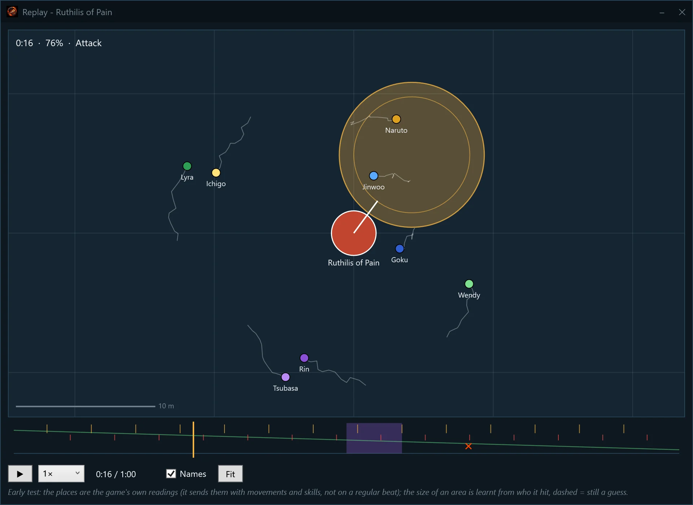
</p>

### Dein ganzer Charakter auf einen Blick

Das **Charakter**-Fenster (Personen-Symbol) zeigt, was das Spiel über dich sendet: Ausrüstung mit Itemlevel und
Verzauberung (einschließlich der Verstärkungsstufe über +15), Arkana, Artenwissen, alle Skills mit ihren Leveln
und die vollständigen Daevanion-Boards. Es merkt sich deinen letzten Login und ist deshalb nie leer. Fahre über ein Teil für seine
Details (Steine, gewürfelte Werte, Götterstein).

Der Meter erkennt außerdem, welches deiner **Skill-Presets** gerade aktiv ist, und merkt sich jedes Preset, das er gesehen hat: Skill-Level, Stigmas und Steine. Der Skills-Tab zeigt jedes Preset mit den Steinen seiner Skills, und der Tooltip eines Skills listet die Steine und die Effekte, die ein Stigma freischaltet, in den Worten des Spiels.

<p align="center">
  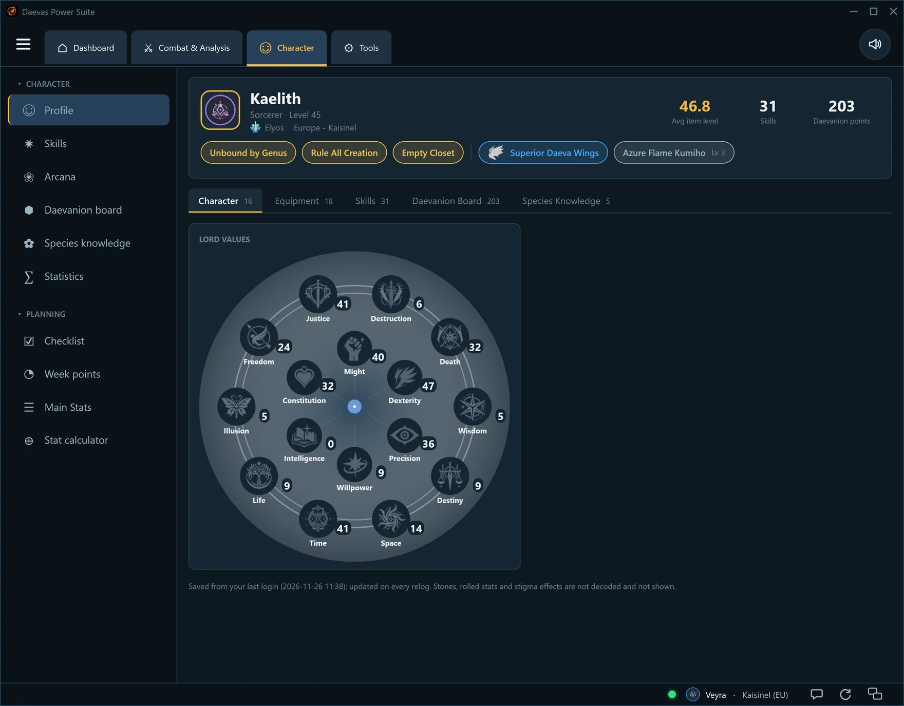
</p>

### Interaktive Karte mit Pets und Sammeln

Ein Karten-Overlay zeigt deine Position, die Spawnpunkte der Pets, hinter denen du her bist, und die Sammelpunkte, die du
eingeschaltet hast — Kräuter, Erze, Holz, Edelsteine und mehr — ohne per Alt-Tab auf eine Webseite zu wechseln. Aufgelistet wird nur, was deine eigene
Fraktion nutzen kann, und die zuletzt bekannte Position bleibt auf der Karte, während das Spiel geschlossen ist. Die Pet-
Einstellungen listen jede Region von Verteron, Altgard und dem Abyss mit ihren Pets und deinem eigenen Pet-Level auf, dazu einen
**Selten**-Tab für Pets mit wenigen Spawnpunkten. Pfeile am Rand zeigen auf das nächste Pet oder Sammelobjekt. In einem Dungeon oder einer Gruppeninstanz wechselt die Karte zu dieser Instanz (25 Karten aus den eigenen Bildern des Spiels, für die Instanzen mit Pet-Monstern) und zeigt deren Pet-Monster.

<p align="center">
  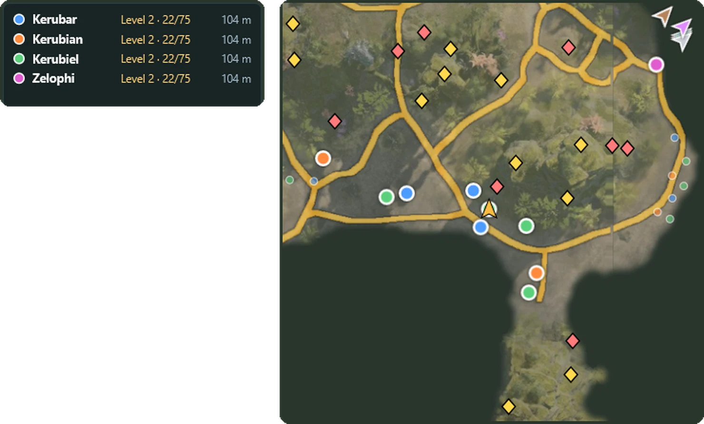
  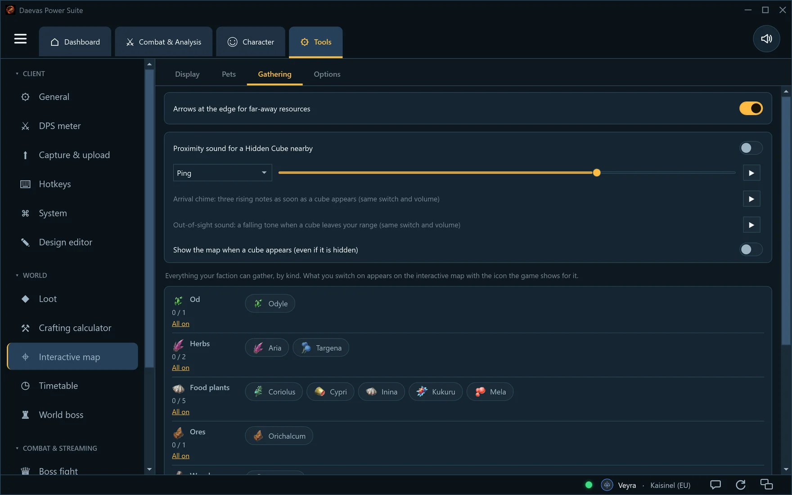
</p>

### Event-Zeitplan mit Erinnerungen

Ein Overlay listet die nächsten Events — Schlachtfeld, die Abyss-Belagerungen (Artefakt-Belagerung), das Shugo-Fest,
den Beritra-Luftangriff, den Raumzeit-Riss und mehr. Wähle pro Event einen Sound und eine Lautstärke und lass dich
wenige Minuten vor dem Start erinnern. Ein Schalter aktiviert oder deaktiviert alle Erinnerungen. Die Zeiten folgen der UTC-Uhr des Spielservers, sind also in jeder Region und in Sommer- wie Winterzeit gleich, und werden in der Zeit deines PCs angezeigt. Auch die Abyss-Vollstrecker-Bosse (Mo, Do, Sa) und Wächterfürstin Nahma (Fr, So) sind aufgelistet, und es stehen zehn Benachrichtigungstöne zur Auswahl.

<p align="center">
  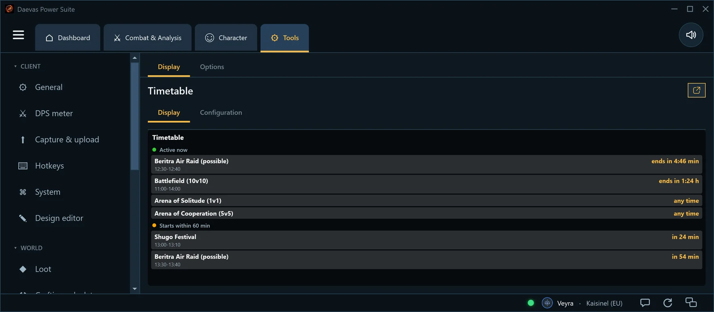
</p>

### Weltbosse in deinem Overlay

Schalte einen Feldboss ein, um seinen Timer im Overlay zu sehen und seinen Sound in dem Moment zu hören, in dem er da ist. Die Zeiten
kommen direkt aus dem Spiel; der Server sendet sie für die Karte, auf der du dich befindest, die anderen Karten zeigen ihre erst,
nachdem du dort warst. Sound und Lautstärke werden pro Boss eingestellt, gruppiert nach Region.

<p align="center">
  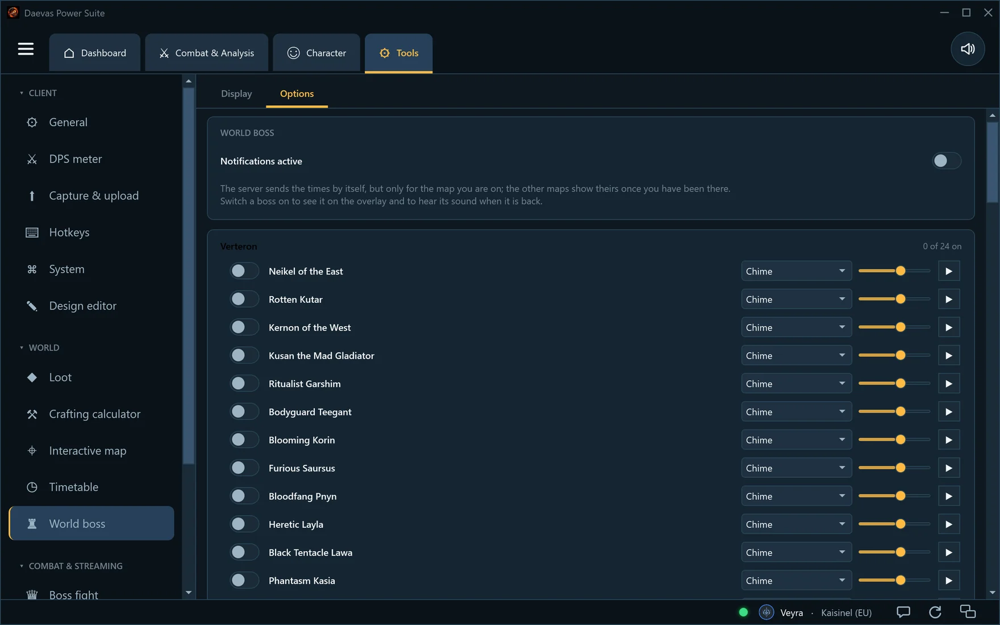
</p>

### Netzwerk-Overlay

Wenn du es einschaltest, sendet das Werkzeug außerdem einen kleinen Ping pro Sekunde an deinen Router, an 1.1.1.1 und an den Spielserver (eine Echo-Anfrage ohne jeden Inhalt), um herauszufinden, woher ein Ruckler kommt; bei ausgeschaltetem Overlay und ausgeschalteter Netzwerkseite wird nichts gesendet.

Ping, Jitter, Datenverkehr, Paketverlust und wie lange du schon online bist, gemessen am Verkehr, den dein PC
ohnehin empfängt. Die Werte wechseln von Grün zu Rot, je schlechter die Verbindung wird. Wähle die gewünschten Zeilen,
sperre die Position, schalte es per Tastenkürzel ein und aus.

<p align="center">
  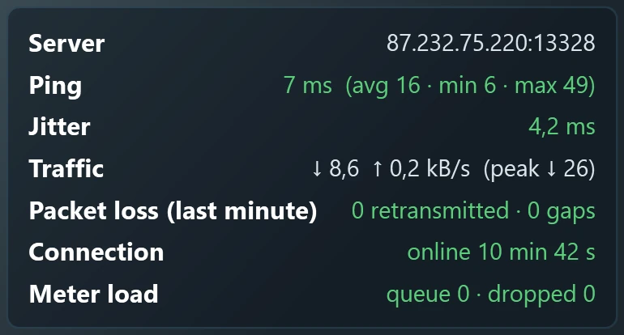
</p>

### Stat-Rechner (Beta)

Sieh, was eine Änderung der Werte für deinen Schaden bedeutet, bevor du ein Teil tauschst. Der Rechner startet mit deinen eigenen Werten, wie das Spiel sie sendet; du gibst an, von welcher Seite du überwiegend angreifst (vorne, hinten, weiß ich nicht) und deine Krit-Rate, oder übernimmst beides aus deinem letzten Kampf. Trage bei einem Wert eine Änderung ein und lies den Schaden damit gegen den Schaden jetzt ab, dazu wie viel von jedem Wert ein Prozent mehr bringt. Der Experten-Modus ergänzt Buffs und die Resistenz des Bosses und ist noch Beta. Das Ergebnis ist eine Näherung, weil die Schadensformel des Spiels nicht veröffentlicht ist: Es sagt „3,8 % mehr“, nie „so viel Schaden“. **Aufnahme starten** schreibt bis zu 10 Minuten lang deine Werte und die Treffer eines Kampfs mit; **Senden** lädt sie hoch, nachdem es genau zeigt, was rausgeht - kein Name, keine Legion, keine IP-Adresse, nur eine zufällige Kennung deiner Installation -, damit der Rechner besser werden kann. Die Idee stammt vom Stat Efficiency Calculator von [RATmeter](https://github.com/Kuroukihime/AIon2-Dps-Meter); Layout, Code und Formel sind unsere eigenen.

### Netzwerk-Bericht

Unter **Tools → Netzwerk**: **Bericht speichern** schreibt die letzten 15 Minuten deiner Verbindung (Ping, Jitter, Paketverlust, die Antwortzeiten von Router, Internet und Spielserver, Aussetzer und ihre Ursache, die Art des Adapters) als formatierte JSON-Datei namens `aiondps_VERSION_DATUM_UHRZEIT.json` dorthin, wo du es auswählst; **Bericht senden** schickt denselben Bericht an den Entwickler. Er enthält keine IP-Adresse von dir und keine Namen (nicht von PC, Windows-Konto, Adapter, Charakter oder Legion); vor dem Senden listet ein Fenster auf, was enthalten ist und was nicht. Die Idee eines gespeicherten Diagnose-Berichts stammt von der Umgebungs-Diagnose des Aletheia-Meters.

### Kampf-Overlay

Ein transparenter Rahmen mit bis zu drei Elementen, die du jeweils einzeln platzierst und in der Größe anpasst:

- **Boss-Zauberleiste:** In dem Moment, in dem ein Boss eine Fähigkeit beginnt, siehst du ihren Namen, eine ablaufende Leiste mit der Restzeit und wen sie trifft (du in Rot). Eine Fähigkeit, die mehrere Spieler getroffen hat, ist mit **FLÄCHE** markiert; **TÖDLICH** bedeutet, dass der höchste Treffer, den du davon bisher erhalten hast, mindestens deinen aktuellen Lebenspunkten entspricht. Der Meter lernt jede Fähigkeit (Fläche oder nicht, wann ihr Schaden eintrifft) und merkt sie sich über Sitzungen hinweg.
- **Ziel des Ziels:** ein Block, der sich als Ganzes verschieben, in der Größe ändern und skalieren lässt, mit Teilen, die du darin auch einzeln platzieren kannst. Zielt das mit Tab gewählte Ziel selbst auf jemanden, siehst du, auf wen: ein Boss mit Bild und Name, ein Spieler mit Klassenemblem und Name. Die **Heiler-Leiste** (optional) ergänzt den Block um den HP-Balken dieses Ziels und die Debuffs (oder Buffs) darauf.

Richte es im Overlay-Designer (**Ctrl+Alt+D**) ein: Zieh den Körper eines Elements, um es zu verschieben, zieh an den Rändern für die Größe, an der Ecke zum Skalieren; der Griff unten rechts am ganzen Rahmen skaliert alle Elemente zusammen. Gesperrt ist es klickdurchlässig und erscheint nur, solange das Spiel im Vordergrund ist. Die gewählte Windows-Stimme kann Boss-Casts auch **per Sprachausgabe ansagen** (mit oder ohne Skillnamen, auf dich, auf alle, tödlich), selbst bei ausgeschaltetem Overlay, solange Aion im Vordergrund ist; in den Einstellungen gibt es Beispielsätze zum Anhören. Das Tastenkürzel *Overlays an / aus* (**Ctrl+Alt+H**) zeigt und versteckt es zusammen mit den anderen.

<p align="center">
  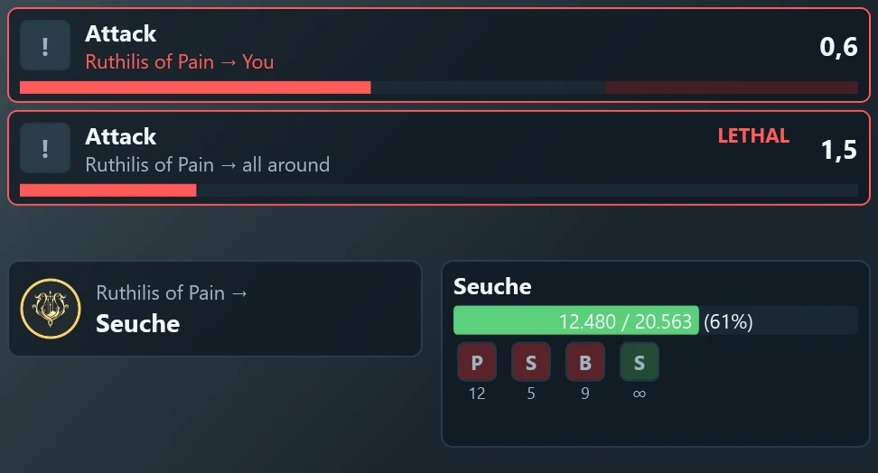
</p>

### Beute, Attribute und die tägliche Checkliste

Das sind Tools unter **Tools**. Das **Beute**-Tool zeigt, was du vom Boden aufhebst, nach Session und Karte, als Seite und als Overlay. Das **Attribute**-Tool zeigt den Attributring mit deinen Punkten, was jedes Attribut und jeder Lord-Wert bewirkt (0,1 % pro Punkt), alle Boni zusammengerechnet und einen Stat-Tab, der jeden Stat mit seinem Anteil aus dem Ring erklärt. Die **Checkliste** führt deine täglichen und wöchentlichen Aufgaben, liest die Pflicht-Tagesquests und den wöchentlichen Odyle-Energie-Kauf aus dem Spiel und überlässt den Rest dem Abhaken von Hand. Jedes Tool merkt sich seine eigene Breite und Höhe.

### Crafting-Rechner

Markiere die Rezepte, die du herstellen willst, und wie oft (für den ganzen Account, damit auch deine Zweitcharaktere sie sehen, oder für einen Charakter), und der **Crafting-Rechner** listet Rezept für Rezept auf, welche Materialien dir noch fehlen. Zwischenprodukte werden in das aufgelöst, was du wirklich sammeln musst: drei Schmiedehämmer brauchen 18 Barren, das sind 36 Erz, und Barren, die du schon hast, zählen zuerst. Der Bestand wird aus dem Spiel gelesen, aus Inventar, Lager und Serverlager, und ein Material, das in einem Lager liegt, sagt das dazu. Lass die Seite auf einem zweiten Bildschirm offen oder zeige dieselbe Liste als Overlay im Spiel. Die Rezepte stammen aus den Tabellen des Spiels; die Reihenfolge deiner Liste bestimmt, welches Rezept den Bestand zuerst bekommt. Log dich einmal ein, damit der Bestand gelesen wird; was du zwischen Inventar und Lager verschiebst, erscheint nach dem nächsten Sortieren.

### Ankündigungen und Twitch Drops

Ein Megafon-Knopf öffnet die offiziellen NCSoft-Ankündigungen auf aiondps.com — Wartungen, Ausfälle, neue
Server, Servertransfers, Entschädigungen — neueste zuerst, mit einem farbigen Label pro Art und einem Filter. Solange
eine AION-2-Twitch-Drops-Kampagne läuft, öffnet ein Twitch-Knopf eine Seite mit ihren Belohnungen, den Stunden, die du
zuschauen musst, einem Countdown und den Streams, bei denen Drops gerade aktiviert sind. Eine Markierung *Neu* zeigt an, wenn
etwas neuer ist als dein letzter Besuch.

<p align="center">
  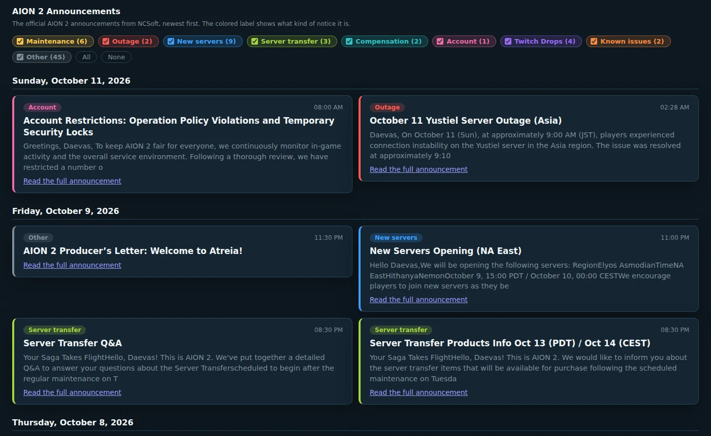
  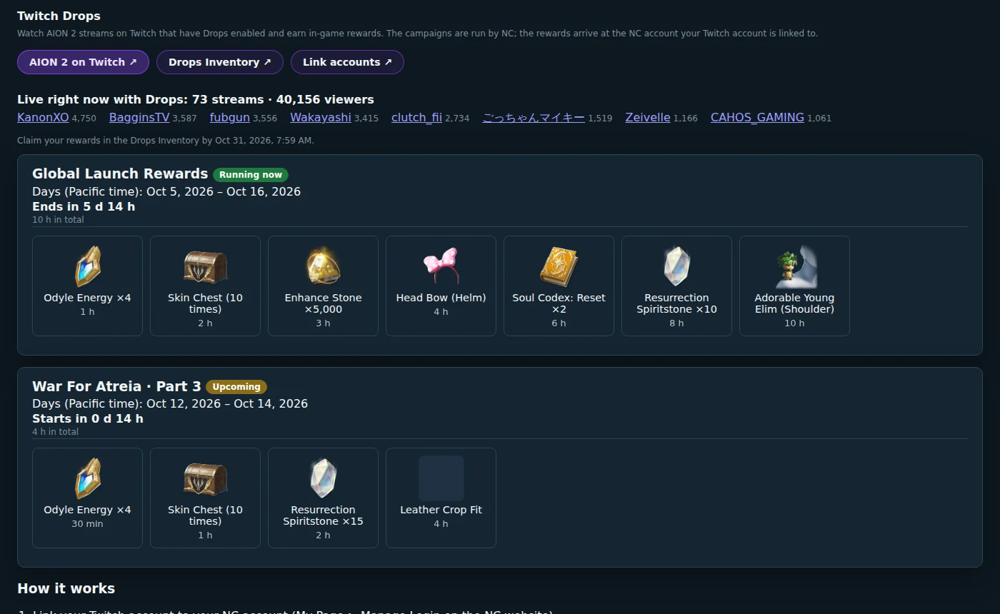
</p>

### Der Meter in deinem Stream (OBS, Streamlabs)

Zeige den Meter live über deinem Spiel, ohne sein Fenster abzufilmen: Schalte im Reiter Konfiguration des Tools Streaming (OBS) **Stream-Overlay für OBS an** ein, nutze dann **Link für OBS kopieren** (oder im Tray-Symbol *Link für das Stream-Overlay (OBS) kopieren*), füge in OBS oder Streamlabs eine **Browser**-Quelle hinzu, füge den Link ein und lege die Größe der Quelle fest. Die Seite folgt dem Meter live: die aktuelle Ansicht (Schaden, Heilung, erlittener Schaden, alles in einer), die Spieler mit Klassensymbol und Balken sowie die Gesundheit des Bosses. Hänge `?scale=1.5` oder `?rows=5` an den Link, um sie zu vergrößern oder weniger Zeilen anzuzeigen.

Es funktioniert auch mit **zwei PCs** (das Spiel auf dem einen, OBS auf dem anderen): Kopiere den Link auf den Streaming-PC, er enthält die Adresse des Spiel-PCs in deinem Netzwerk. Erreichbar ist er nur aus deinem eigenen Netzwerk, nie aus dem Internet; der Link enthält einen zufälligen Schlüssel (**Neuer Schlüssel** macht den alten Link ungültig), es wird nur `GET` bedient, die Seite lädt nichts von anderswo, und nichts wird an jemanden gesendet. Windows fragt einmal, ob der Meter durch die Firewall darf: für private Netzwerke erlauben. Spielernamen sind **standardmäßig aus** - alle erscheinen mit ihrer Klasse, wie bei den Uploads - und lassen sich in derselben Einstellungskarte einschalten.

### Verlauf und Statistiken

Deine Kämpfe, Charaktere und die Zähler der Checkliste werden in einer Datenbank auf deinem PC aufbewahrt (ältere Einträge werden nach 90 Tagen ausgedünnt); nichts davon wird hochgeladen. Der **Charakter**-Reiter zeigt deine Instanzen, Boss-Kills mit dem besten DPS, die Entwicklung von Ausrüstungswert und Kampfkraft über die Zeit, den Attributring und eine Werte-Karte nach dem Vorbild des Statfensters des Spiels und - wenn du die Abfrage erlaubst - was aiondps.com aus den Uploads aller über deinen Charakter weiß.

### Sessions

Jede Karte und jede Instanz wird als eigene Session aufgezeichnet, damit du dir einen früheren Durchlauf noch einmal ansehen kannst. Ein Plausibilitätscheck vergleicht den Schaden mit den verlorenen Lebenspunkten des Bosses.

<p align="center">
  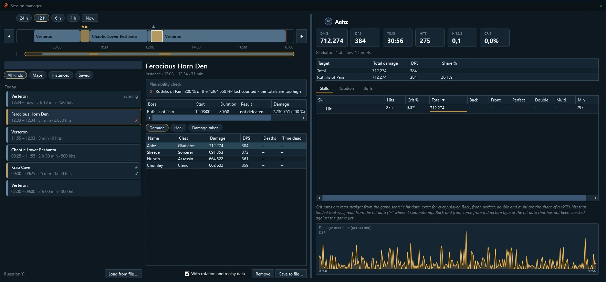
</p>

Session-Manager und **Kampf-Analysator** teilen sich ein Fenster mit verschiebbarem Trenner: links eine Session wählen, rechts öffnen sich die Spielerdetails (Skills, Rotation, Effekte, die Replay-Karte), begrenzt auf diese Session. Über der Spielerliste schaltest du zwischen **Schaden, Heilung und erlittenem Schaden** um; die Liste zeigt die Tode und wie lange jeder Spieler tot war. Der Meter selbst zeichnet im Hintergrund weiter auf. **In Datei speichern** kann Rotation, Effekte und Replay-Daten mitnehmen (ein Kontrollkästchen, das gemerkt wird; die Datei wird um ein Vielfaches größer, etwa 0,5 bis 5 MB bei einem Bosskampf von fünf Minuten), damit auch eine geladene Datei sie zeigt. Das Fenster merkt sich seinen Platz und den Trenner.

## Benutzung

Die Aufnahme beginnt, sobald der Meter läuft. **Pause verwirft** statt zu puffern: Ereignisse
während einer Pause sind für immer weg, ein Fortsetzen spielt also nie einen Kampf nach, den du ausgesessen hast.

- **Copy** legt ein einzeiliges, chatfertiges Ranking in die Zwischenablage (`Name 1.234.567 (890), …`); **Copy All**
  liefert eine Discord-Markdown-Tabelle.
- Das Aussehen wird unter **Tools → Client → Allgemein** festgelegt: Theme (dunkel/hell), Schriftgröße, Sprache, Start mit Windows; Optik und Deckkraft jedes Overlays stellst du im Overlay-Designer ein.
- Deine Einstellungen überstehen einen Absturz: Die Einstellungsdatei wird in einem Zug geschrieben, und eine Kopie vom letzten Start liegt daneben. Ist die Datei einmal beschädigt, wird diese Kopie wiederhergestellt (die beschädigte Datei bleibt daneben erhalten). **Tools → Client → System → Alle Einstellungen auf Standard zurücksetzen** fragt zweimal nach und lässt sich 30 Sekunden lang rückgängig machen; deine Upload- und Datenschutz-Entscheidungen, die Update-Prüfung und dein Charakter bleiben dabei, wie sie sind.

<p align="center">
  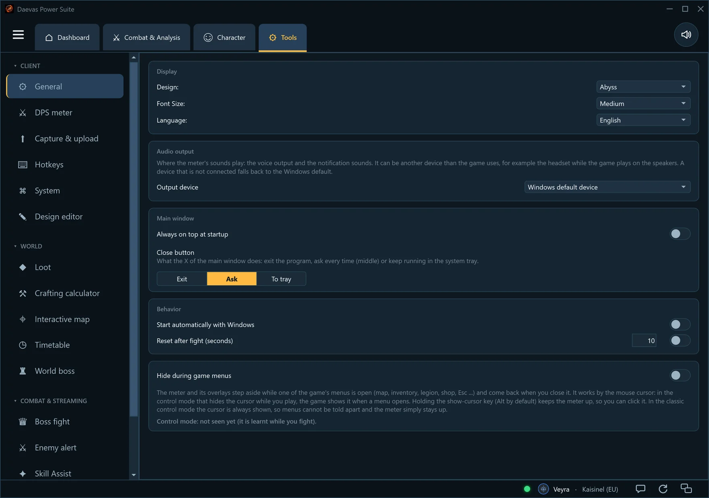
  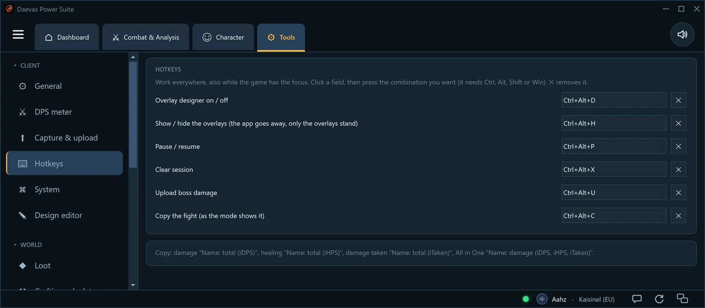
</p>

## Tastenkürzel

Systemweit, auch wenn das Spiel den Fokus hat. Klicke unter **Tools → Client → Tastenkürzel** auf ein Feld und drücke die
gewünschte Kombination (sie braucht Ctrl, Alt, Shift oder Win); **×** entfernt sie. Sie ersetzen Chat-Befehle,
die nicht funktionieren können, weil der Chat von Aion 2 im Netzwerkverkehr nicht lesbar ist.

| Standard | Aktion |
|---|---|
| **Ctrl+Alt+D** | Overlay-Designer |
| **Ctrl+Alt+H** | Overlays an / aus (das Fenster verschwindet und die Overlays stehen, oder das Fenster ist zurück und sie sind weg) |
| **Ctrl+Alt+P** | Pause / Fortsetzen |
| **Ctrl+Alt+X** | Sitzung leeren |
| **Ctrl+Alt+U** | Boss-Schaden hochladen |
| **Ctrl+Alt+C** | Schadens-Ranking kopieren (folgt dem gewählten Modus) |

## Uploads

- **Boss-Kämpfe** werden hochgeladen, wenn du auf Upload klickst (der Upload-Knopf oder **Ctrl+Alt+U**): der
  Boss, die beteiligten Spieler, Schaden, Heilung, erlittener Schaden und Skills. Angenommen werden nur Bosse, die das Spiel
  angekündigt hat und der Katalog kennt. Automatischer Upload ist verfügbar und **standardmäßig aus**.
- **Dein eigenes Charakterprofil** (Name, Klasse, Level, Ausrüstung, Skills, Daevanion, Legion, Server, Ränge, Pantheon, Titel, Pets, Flügel, Attribute, Skill-Presets mit Aktionsleisten und Makros, Odyle-Energie und ein Hash deines Account-Schlüssels) kann
  wenige Sekunden nach dem Login automatisch hochgeladen werden, damit man dich auf der Webseite findet. Das ist
  **standardmäßig aus**; schalte es unter **Tools → Client → Aufnahme & Upload** ein. Profile anderer Spieler werden nur mit einem zweiten, eigenen Schalter gesendet.
- Ohne Upload verlassen nur die Update-Prüfung und die in der [Datenschutzerklärung](https://aiondps.com/privacy) aufgeführten Anfragen deinen Rechner.

## Updates

Der Meter aktualisiert sich selbst. Er fragt beim Start und danach alle fünf Minuten, solange er läuft, GitHub nach einer neueren Version,
lädt sie im Hintergrund herunter und tauscht sie beim nächsten Start ein — kein Installer, kein UAC-Dialog. Ist ein Update bereit,
erscheint eine grüne Zeile in der Statuszeile (und ein Abzeichen im transparenten
Overlay); ein Klick darauf bietet den sofortigen Neustart an. Der Update-Knopf in der Kopfzeile und die Prüfung in der Fußzeile machen dasselbe auf Wunsch.
Eine alte Version lädt noch 72 Stunden nach Erscheinen ihres Nachfolgers hoch, danach muss sie aktualisiert werden.

Die Prüfung liest eine einzige URL und sendet nichts außer der Anfrage selbst:

```
https://api.github.com/repos/SkeeveAN/Aion-DPS-Meter/releases
```

Schalte sie unter **Tools → Client → System** ab; die Prüfung von Hand funktioniert auch dann weiter.

## Sprachen

Englisch, Deutsch, Französisch, Spanisch, Russisch, Chinesisch (vereinfacht und traditionell), Portugiesisch (Brasilien),
Japanisch und Koreanisch — einzustellen unter **Tools → Client → Allgemein**. Diese README gibt es auch auf
[Deutsch](README.de.md), [Español](README.es.md), [Français](README.fr.md), [Русский](README.ru.md),
[中文](README.zh.md), [繁體中文](README.zh-TW.md), [Português (Brasil)](README.pt.md),
[日本語](README.ja.md) und [한국어](README.ko.md).

## Aus dem Quellcode bauen

```
cd Client
dotnet build
dotnet run -- selftest                              # Selbsttests (Protokoll, Capture, Dekodierung, ...)
dotnet run -- aion2-record <out.jsonl>              # Verkehr des Spiels aufnehmen ("stop" beendet)
dotnet run -- aion2-replay <file.jsonl>             # Aufnahme durch den echten Decoder abspielen
dotnet run -- aion2-upload-dryrun <file.jsonl>      # Uploads einer Aufnahme bauen, nichts senden
```

Nur Windows (WPF). `Tools/aion2-dat` liest die Texttabellen des Spiels (Namen in acht Sprachen); siehe dessen README.

## Hinweis zu Serverregeln

NCSOFT hat dieses Werkzeug nicht freigegeben. Die Betriebsrichtlinien sanktionieren „nicht autorisierte Programme“: Programme oder Vorrichtungen, die technische Schutzmaßnahmen umgehen oder den ordnungsgemäßen Betrieb beeinträchtigen, etwa Programme, die Handlungen ermöglichen, zu denen reguläre Spieler nicht in der Lage sind, sowie das Erstellen oder Verbreiten solcher Programme und das Verändern von Client- oder Serverprogrammen. Bots werden gesondert genannt, und ein Hinweis zum Vertrauensstatus eines Kontos erwähnt „verdächtige Software“, ohne sie zu definieren. NCSOFT nennt Verhaltensweisen, keine einzelnen Programme; Schadensmeter und das passive Mitlesen von Netzwerkverkehr sind weder aufgelistet noch ausdrücklich verboten, die Liste ist aber nicht abschließend. Der Meter spielt nichts für dich, automatisiert nichts, erhöht weder Schaden noch Geschwindigkeit, liest keinen Spielspeicher, verändert weder Client noch Server und sendet keine Spieldaten an das Spiel (der Ping des Netzwerk-Werkzeugs, das du selbst einschaltest, enthält keinen Spielinhalt); dass er außerhalb der Definition liegt, ist unsere Lesart, keine Aussage von NCSOFT. Prüfe [die aktuellen Regeln](https://aion2.plaync.com/de-de/board/rules/list) und nutze ihn auf eigene Verantwortung.

## Haftungsausschluss und Lizenz

Aion 2 und alle zugehörigen Namen, Texte und Grafiken sind Eigentum von NCSOFT. Dieses Projekt steht in keiner Verbindung zu NCSOFT und wird weder von NCSOFT unterstützt noch gebilligt; Spielinhalte verbleiben bei ihrem Eigentümer. Der Quellcode steht unter der [MIT-Lizenz](LICENSE) — sie gilt nur für den Code, nicht für Spielinhalte.
