🇬🇧 [English](README.md) · 🇩🇪 [Deutsch](README.de.md) · 🇪🇸 [Español](README.es.md) · 🇫🇷 [Français](README.fr.md) · 🇷🇺 [Русский](README.ru.md) · 🇨🇳 [中文](README.zh.md) · 🇹🇼 [繁體中文](README.zh-TW.md) · 🇧🇷 [Português (Brasil)](README.pt.md) · 🇯🇵 **日本語** · 🇰🇷 [한국어](README.ko.md)

# Aion DPS Meter

**AION 2 向けの無料DPSメーター** — パーティ全員のダメージと回復をリアルタイム表示。クリックを通すオーバーレイ、ボスランキング、ペットと採集のマップ、イベントスケジュール、ワールドボスのタイマーを備えています。Windows対応、オープンソースで、ゲームのメモリは一切読み取りません。

<p align="center">
  <a href="../../releases/latest"><b>⬇ Windows版をダウンロード</b></a> · <a href="https://aiondps.com">ウェブサイト</a> · <a href="https://aiondps.com/features">すべての機能</a> · <a href="https://aiondps.com/instances">ボスランキング</a>
</p>

<p align="center">
  <a href="../../releases/latest"></a>
  <a href="../../releases"></a>
  <a href="LICENSE"></a>
  
</p>

<p align="center">
  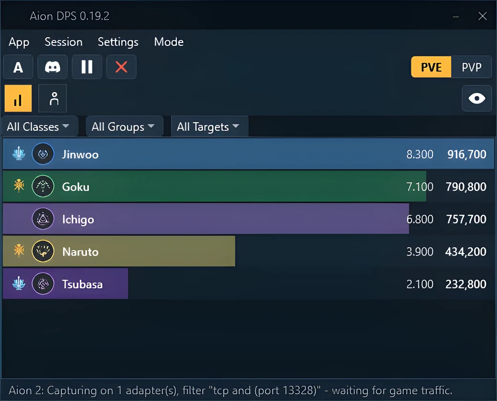
  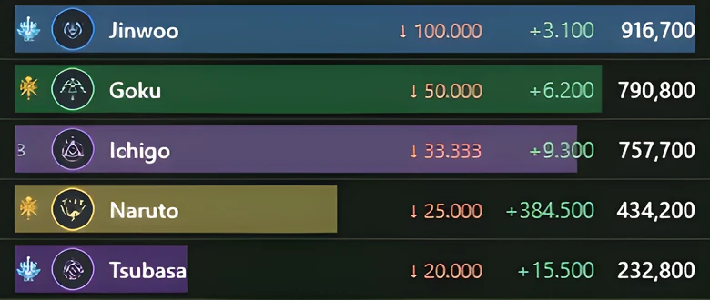
</p>

> 以下の画像に表示されている名前、プレイヤー、数値はデモデータです。

## 選ばれる理由

- パーティやレイドの全員のDPS、iDPS、HPSをリアルタイム表示
- クリックを一切妨げないオーバーレイ
- クリティカル率とDPSカーブ付きのスキル内訳
- aiondps.com のボスランキングと公開キャラクタープロフィール（アップロードは任意、初期設定はオフ）
- インタラクティブマップ、イベントスケジュール、ワールドボスタイマー、ネットワークオーバーレイ
- ボスのキャストを音声で通知、ルートログ、アトリビュートツール、デイリーチェックリスト
- 安全: パッシブなパケットキャプチャのみ。メモリ読み取りもコード注入もなし
- 無料、オープンソース（MIT）、自動アップデート

AION 2 のグローバル版に対応しています。NCSOFT が2026年10月5日にリリースしたすべてのリージョンが対象です。韓国と台湾は数バージョン先行しているため、スキル認識が不完全な場合があります。

**Aion 2** 向けのダメージ/回復メーターとツールキットです。お使いのPC上で、ゲーム自身のネットワーク通信を
[Npcap](https://npcap.com) ドライバー経由で読み取ります。完全にパッシブで、パケットを送信することも、
ゲームプロセスやそのメモリに触れることもありません。アップロードしない限り、プレイに関する情報がPCの外に出ることはありません
（[アップロード](#アップロード)を参照）。それ以外に送信されるのはアップデート確認のみで、GitHubに新しいリリースがあるかを
問い合わせるもので、オフにできます。[更新](#更新)を参照してください。


## 目次

[インストール](#インストール) · [できること](#できること) · [使い方](#使い方) · [ホットキー](#ホットキー) ·
[アップロード](#アップロード) · [更新](#更新) · [言語](#言語) · [ソースからのビルド](#ソースからのビルド)

## インストール

1. [Npcap](https://npcap.com) ドライバーをインストールします（メーターがゲームの通信を認識するために必要です。
   インストーラーには含まれていません）。
2. [最新リリース](../../releases/latest)から `AionDpsMeter-win-Setup.exe` をダウンロードして実行します。
   ユーザープロファイル内にインストールされ、メーターが起動します。管理者権限も .NET も不要です。
3. メーターを起動してから、キャラクターでログインします。メーターはキャラクター、装備、スキル、
   デーヴァニオンボードをゲーム自体から読み取ります。プレイ中のサーバーは自動的に検出されます。

## できること

### 全員のリアルタイムのダメージと回復

パーティーやレイドの全プレイヤーを、名前、総ダメージ、DPS、シェアバーとともに表示します。陣営とクラスはアイコンで
表示されます。クラス、グループ、ターゲットで絞り込めます。**モブ/ボス**フィルターは、全体のDPSと
ターゲットごとの正確な **iDPS** を切り替えます。ボスはゲーム自身のデータから認識され、名前で表示されます。**PVE/PVP**の
切り替えで両者を分けられ、ボス戦での全滅には専用のエントリーが作られます（ドクロは、その後ボスが
全回復した挑戦を示します）。

### 5つのビューをワンクリックで切り替え

**ダメージ**、**回復**、**被ダメージ**、そして2つの**オールインワン**ビューです。ホットキー
（デフォルトは **Ctrl+Alt+M**）で切り替えるか、オーバーレイ上のモード表示をクリックします。*オールインワン*は被ダメージ、
回復、合計を並べて表示し、*オールインワン コンパクト*はおなじみのDPS列と合計列を維持したまま、
回復と被ダメージを名前の下の小さな2行目に表示します。

<p align="center">
  
  
</p>

### クリックを透過するオーバーレイ

**UI 非表示**にすると、ウィンドウが小さなチップ（またはコンパクトなパネル）に変わり、クリックを一切奪うことなく
Aion 2 の上に重なって表示されます。透明度、ダメージシェアバー、ボスの体力、プレイヤーごとの被ダメージは
オプションで設定できます。コンパクトパネルは、マウスクリックをゲームに通すようにも設定できます。オーバーレイはゲームが最前面にあるときだけ描画されます。ホットキーでどこからでも切り替えられます。

オプション（**設定 → インターフェース → ゲームのメニュー表示中は隠す**、初期設定ではオフ）：ゲームのメニュー（マップ、インベントリ、レギオン、ショップ、Esc など）が開いている間、メーターとそのオーバーレイは身を引き、メニューを閉じると戻ってきます。判定にはマウスカーソルを使います。プレイ中にカーソルを隠す操作モードでは、メニューが開くとゲームがカーソルを表示します。カーソル表示キー（初期設定は Alt）を押し続けるとメーターが表示されたままになり、クリックできます。また **Ctrl+Alt+J** で、開いているメニュー中にオーバーレイを表示できます。クラシック操作モードではカーソルが常に表示されるため、メニューを見分けられません。メーターは戦闘中にそれを検知し、そのまま表示され続けます。

### 全プレイヤーのスキル内訳

プレイヤーを**ダブルクリック**します。各スキルのヒット数、クリティカル率、合計、最小、最大、平均がターゲット別に表示され、
戦闘全体のDPS推移グラフも見られます。クリティカル率はサーバーのヒットデータから直接読み取るため、正確です。表にはスキルのヒットの当たり方も表示されます。**背面**、**正面**、**パーフェクト**、**ダブル**、**多段**（1回のヒットに複数回の攻撃）が、直接ヒットに占める割合としてヒットデータから読み取られます。ダブル（ダメージ約2倍）、パーフェクト（小さなボーナス）、パリィは、与えるダメージで検証済みです。背面と正面は方向バイトに基づいており、ゲームとの照合はまだ行われていません。その旨はウィンドウにも表示されます。

<p align="center">
  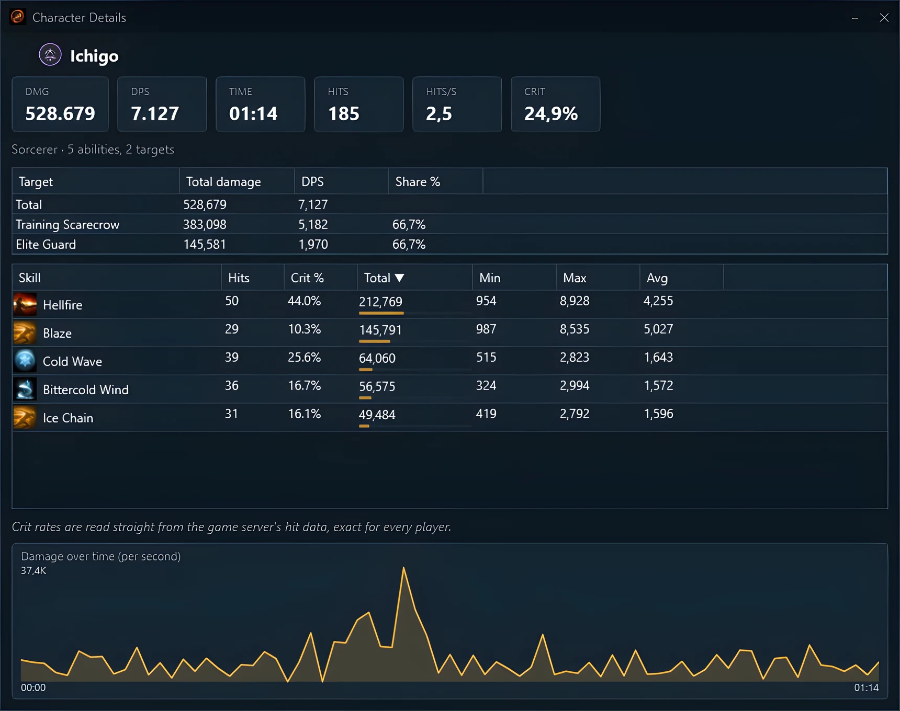
</p>

### ローテーション、効果、スタッガー

同じウィンドウにはさらに2つのタブがあります。**ローテーション**は、プレイヤーが使用したすべてのスキルを、使用した瞬間のタイムライン上に描きます。サポートスキルは上のレーン、ダメージスキルは下に表示され、別のスキルの直後に挟み込まれたスキルは1行下に表示されるため、挟み込みが続くと階段のように見えます。背景にはプレイヤーのDPS（直近5秒の平均）と、モンスターがスタッガー状態になった瞬間が流れます。ドラッグで戦闘中を移動でき、**Ctrl + ホイール**でズームし、アイコンにカーソルを合わせると、その使用（いつ、何回中の何回目か、前回からの時間、そのときのDPS）が表示されます。下には**オープナー**（最初のスキルを順番に）と*ローテーションの要約*があります。使用回数、毎分、間隔（2回の使用の間の時間）、初回、そしてダメージの割合です。**効果**は、プレイヤーにかかっていたすべての効果を、その稼働時間、そのうちプレイヤー自身によるもの、付与された回数、付与した人とともに一覧にします。2人のプレイヤーが同時に維持していた効果は1回として数えます。

ローテーションデータ付きでファイルに保存したセッション(「セッション」を参照)は、読み込み後も表示されます。

<p align="center">
  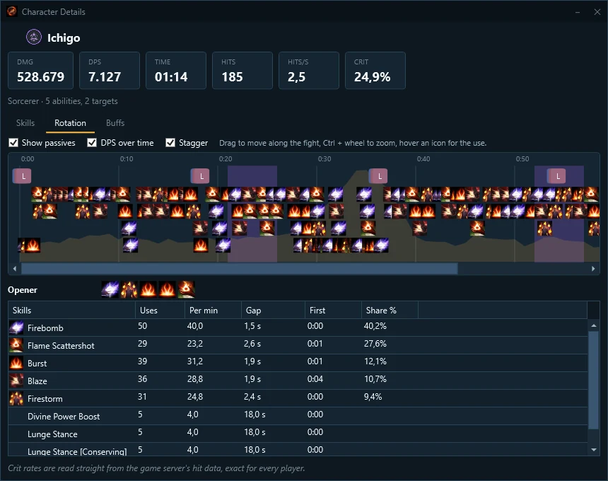
</p>

### ボス戦のリプレイ（早期テスト）

ボス戦のプレイヤーウィンドウで**リプレイ**を押すと、戦闘を真上から再生します。パーティーはクラス色の点で、直近数秒の移動の軌跡つき。ボスは向いている方向と体力つき。ボスが準備中のスキルの範囲は、準備中は琥珀色、着弾すると赤で表示され、大きさがまだ推測の間は破線になります。攻撃を受けた相手には赤いリングが付き、倒れた人には取り消し線が引かれます。マップの下のタイムラインには、ボスの大技（琥珀色）、パーティーへのヒット（赤）、死亡、スタッガー（網掛け）、ボスの体力が表示されます。クリックまたはドラッグでその時点に移動できます。再生と一時停止（スペース）、速度は半分から4倍まで、← と → で5秒ずつ移動、マップのドラッグ、ホイールでズーム、ダブルクリックで再びフィットします。

位置情報はゲーム自身の読み取り値です。ゲームは移動やスキルとともにそれらを送信し、一定間隔では送らないため、2点の間の移動は直線で描かれます。ゲームは攻撃範囲の大きさを一切伝えません。メーターは、各スキルが誰に当たったかから大きさを学習し、戦闘をまたいで記憶します。表示されるのはあなたのパーティーとボスだけで、他のプレイヤーは表示されません。戦闘のリプレイはローカルの履歴に保存されます。古いバージョンで記録した戦闘にはリプレイがありません。

<p align="center">
  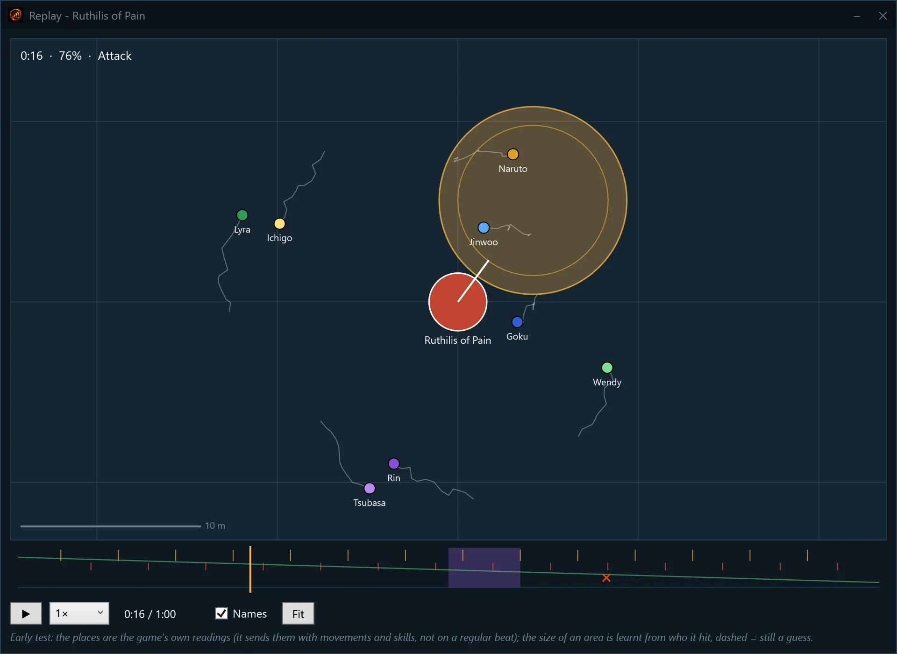
</p>

### キャラクターの全情報をひと目で

**キャラクター**ウィンドウ（人物アイコン）には、ゲームが送ってくるあなたの情報が表示されます。アイテムレベルと
強化値（+15を超えるアンプリファイ段階を含む）付きの装備、アルカナ、種族知識、レベル付きの全スキル、
そしてデーヴァニオンボード全体です。最後のログイン情報が保持されるため、空になることはありません。装備品にカーソルを合わせると
詳細（ストーン、ランダム能力値、ゴッドストーン）が表示されます。

メーターは、どの**スキルプリセット**が有効かも検知し、確認したすべてのプリセット（スキルレベル、スティグマ、ストーン）を保持します。スキルタブには各プリセットがスキルのストーンとともに表示され、スキルのツールチップには、ストーンやスティグマが解放する効果がゲーム自身の言葉で一覧表示されます。

<p align="center">
  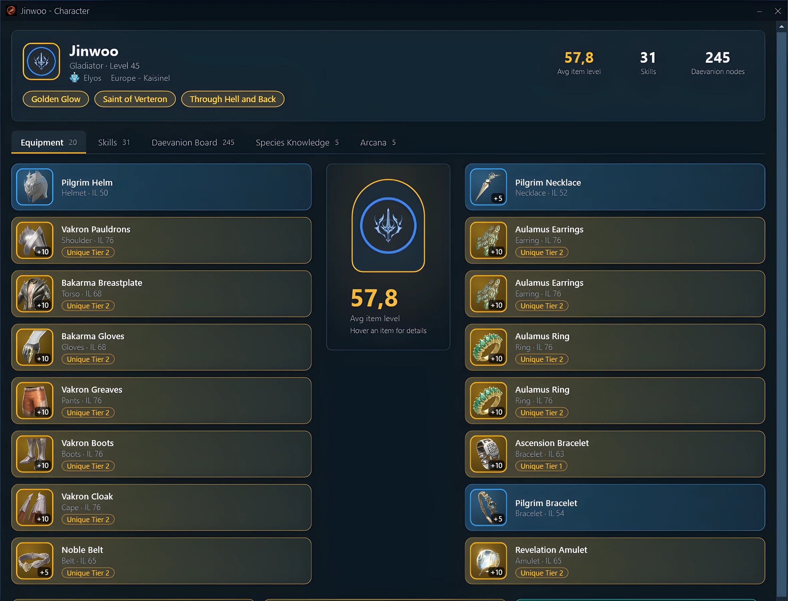
</p>

### ペットと採集に対応したインタラクティブマップ

マップオーバーレイには、あなたの位置、狙っているペットの出現ポイント、オンにした採集スポット（薬草、鉱石、木材、宝石など）が
表示されるため、ウェブサイトにAlt+Tabで切り替える必要がありません。自分の陣営が利用できるものだけが表示され、ゲームを閉じている間も
最後に確認された位置がマップに残ります。ペット設定には、ベルテロン、アルトガルド、アビスの全地域が、そこにいるペットと
自分のペットレベルとともに一覧表示され、出現ポイントの少ないペット用の**レア**タブもあります。画面端の矢印が最も近いペットや採集物を指し示します。ダンジョンやパーティーインスタンスの中では、マップがそのインスタンスに切り替わり（ペットモンスターがいるインスタンス向けに、ゲーム自身の画像から作った25枚のマップ）、そのペットモンスターが表示されます。

<p align="center">
  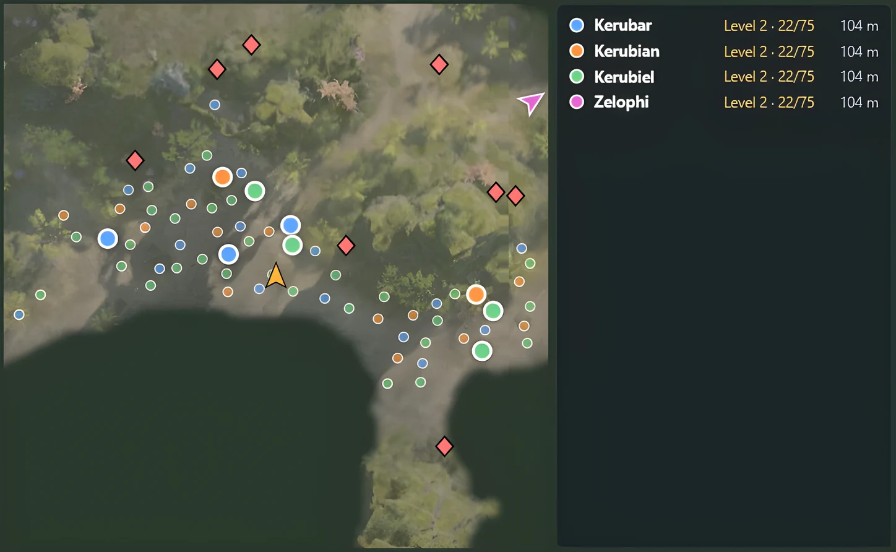
  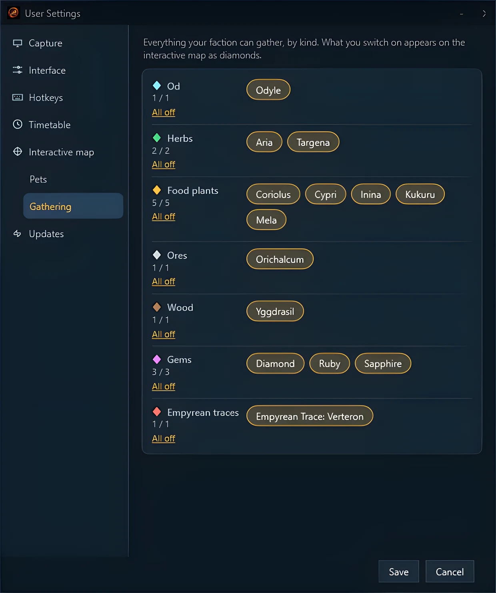
</p>

### リマインダー付きイベントタイムテーブル

オーバーレイに次のイベントが一覧表示されます。バトルフィールド、アビスの攻城戦（アーティファクト攻城戦）、シュゴフェスタ、
ベリトラの空襲、時空の裂け目などです。イベントごとにサウンドと音量を選べ、開始の数分前に
通知を受け取れます。ひとつのスイッチですべてのリマインダーをオン/オフできます。時刻はゲームサーバーのUTC時計に従うため、どのリージョンでも、夏時間・冬時間でも同じで、PCの時刻で表示されます。アビスのエクセキューターボス（月・木・土）とガーディアンロード・ナフマ（金・日）も一覧に載り、通知サウンドは10種類から選べます。

<p align="center">
  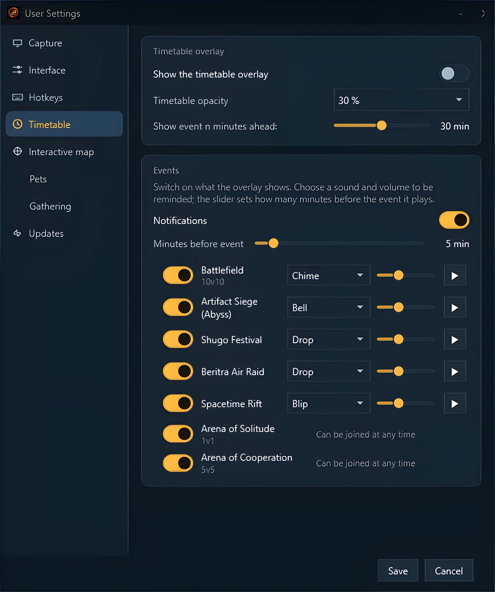
</p>

### オーバーレイに表示するワールドボス

フィールドボスをオンにすると、そのタイマーがオーバーレイに表示され、出現した瞬間にサウンドが鳴ります。時刻は
ゲームから直接取得されます。サーバーは今いるマップの分を送信し、他のマップの分は
一度訪れると表示されます。サウンドと音量はボスごとに、地域別にまとめて設定します。

<p align="center">
  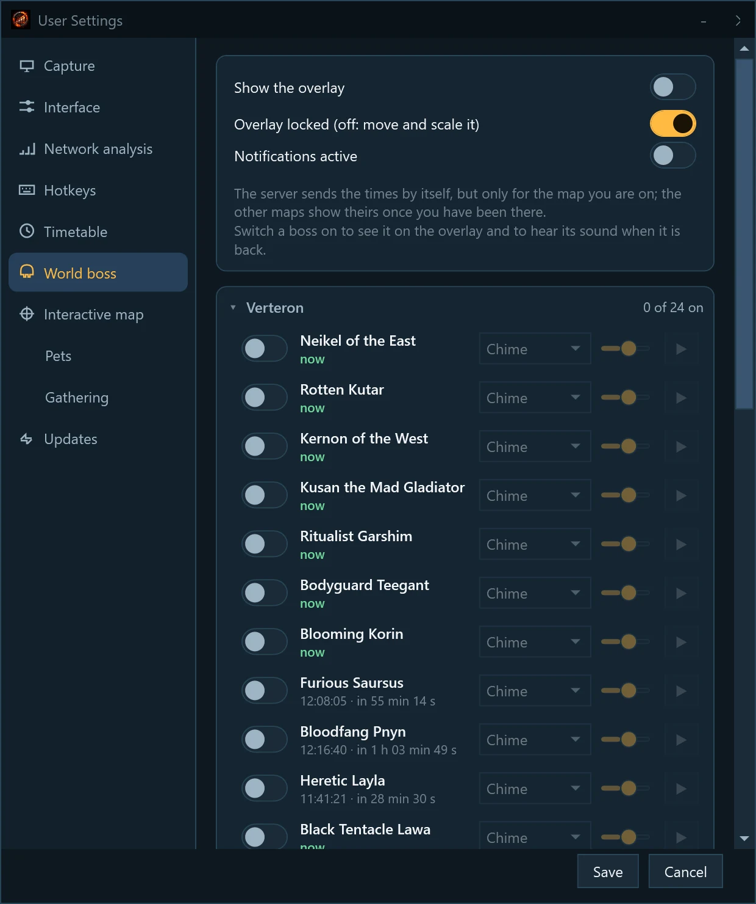
</p>

### ネットワークオーバーレイ

ピング、ジッター、トラフィック、パケットロス、オンライン時間を、PCがすでに受信している通信から測定します。接続状態が悪くなるほど、
値は緑から赤に変わります。表示する行を選び、位置を固定し、ホットキーでオン/オフを切り替えられます。

<p align="center">
  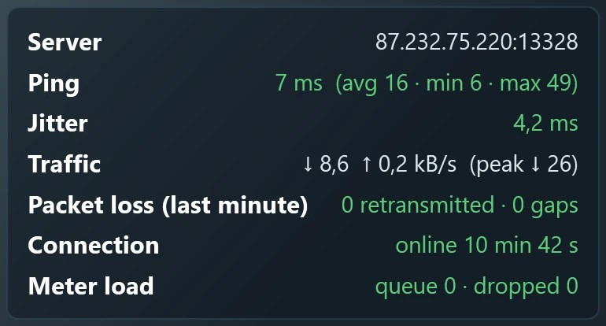
</p>

### 戦闘オーバーレイ

最大3つの要素を持つ1枚の透明なフレームで、各要素は個別に配置とサイズ調整ができます:

- **ボスのキャストバー:** ボスがスキルを使い始めた瞬間に、その名前、残り時間とともに減っていくバー、そして誰を狙っているか(あなたは赤)が表示されます。複数のプレイヤーに当たったスキルには**範囲**と表示されます。**致命的**は、そのスキルでこれまでに受けた最大ダメージが現在のHP以上であることを意味します。メーターは各スキル(範囲かどうか、ダメージがいつ入るか)を学習し、セッションをまたいで記憶します。
- **ターゲットのターゲット:** ブロック全体をまとめて移動・サイズ変更・拡大縮小でき、中の各パーツも個別に配置できます。Tabで選択したターゲット自身が誰かを狙っている場合、それが誰かが表示されます。ボスなら画像と名前、プレイヤーならクラスエンブレムと名前です。**ヒーラーバー**(任意)をオンにすると、そのターゲットのHPバーとデバフ(またはバフ)がブロックに加わります。

**設定 → ボス戦**でオーバーレイのロックを解除して配置します。要素の本体をドラッグして移動、端を引っ張ってサイズ変更、角を引っ張って拡大縮小します。フレーム全体の右下のグリップは、すべての要素をまとめて拡大縮小します。ロック中はクリックが通り抜け、ゲームが前面にあるときだけ表示されます。選択したWindowsの音声で**ボスのキャストを音声で通知**することもできます（スキル名の有無、自分向け、全員向け、致命的を選択可）。Aionが前面にあれば、オーバーレイをオフにしていても通知されます。設定には試し聞きできる例文があります。**Ctrl+Alt+C** でオン/オフを切り替えでき、*すべてのオーバーレイ オン / オフ*のホットキーでも切り替わります。

<p align="center">
  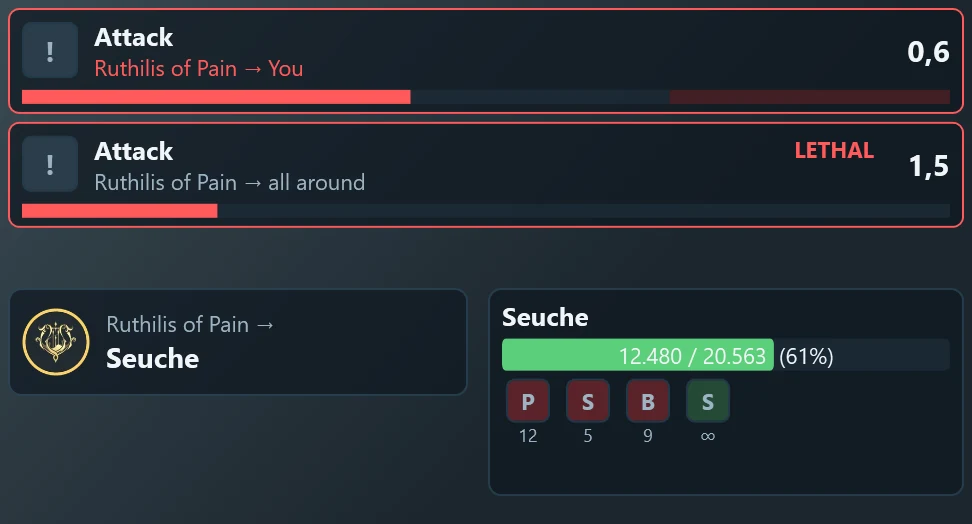
</p>

### ルート、アトリビュート、デイリーチェックリスト

**ツール**ウィンドウの左側にこれらが一覧表示されます。**ルート**ツールは、地面から拾ったものをセッションとマップ別に、ページとオーバーレイ（**Ctrl+Alt+L**）で表示します。**アトリビュート**ツールは、ポイントを割り振ったアトリビュートリング、各アトリビュートとロード値の効果（1ポイントあたり0.1 %）、すべてのボーナスの合計、そしてリングからの割合とともにすべてのステータスを説明するステータスタブを表示します。**チェックリスト**はデイリーとウィークリーのタスクを保持し、必須のデイリークエストと毎週のオディル エネルギー購入をゲームから読み取り、残りは手動でチェックします。各ツールは自分の幅と高さを記憶します。

### お知らせとTwitchドロップ

メガホンのボタンを押すと、aiondps.com でNCSoftの公式お知らせが開きます。メンテナンス、障害、新サーバー、
サーバー移転、補償などが新しい順に並び、種類ごとの色付きラベルとフィルターが付いています。AION 2 のTwitchドロップキャンペーンが
開催されている間は、Twitchボタンから報酬、視聴が必要な時間、カウントダウン、現在ドロップが有効な
配信をまとめたページが開きます。前回の訪問より新しい情報があると、*新着*マークが表示されます。

<p align="center">
  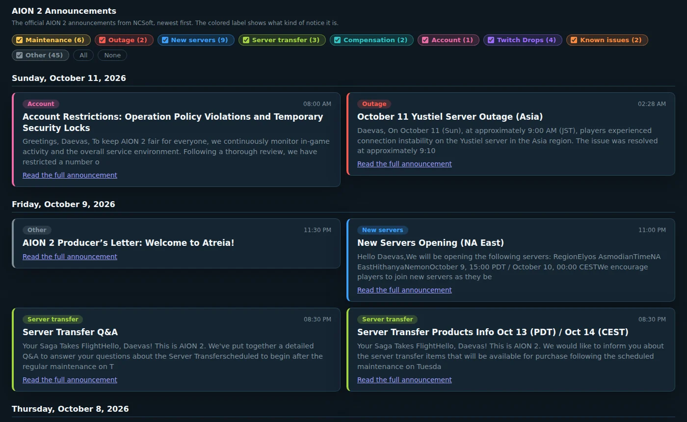
  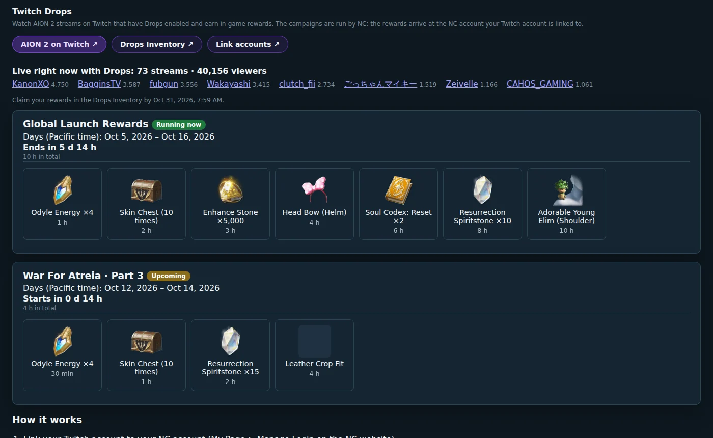
</p>

### 配信でメーターを表示する（OBS、Streamlabs）

メーターのウィンドウを映さずに、ゲーム画面の上にメーターをライブ表示できます。**設定 → 配信 → OBS用の配信オーバーレイをオン** を有効にし、**OBS用リンクをコピー**（またはトレイアイコンの *配信オーバーレイのリンクをコピー (OBS)*）を使ってリンクをコピーします。OBS または Streamlabs で **ブラウザ** ソースを追加し、リンクを貼り付けてソースのサイズを設定してください。このページはメーターにリアルタイムで追従し、現在のビュー（ダメージ、回復、被ダメージをひとつにまとめたもの）、クラスアイコンとバー付きのプレイヤー、ボスの体力を表示します。リンクに `?scale=1.5` または `?rows=5` を付けると、拡大したり表示行数を減らしたりできます。

**2台のPC**(片方でゲーム、もう片方でOBS)でも使えます。リンクを配信用PCにコピーしてください。リンクにはゲームPCのネットワーク上のアドレスが含まれます。アクセスできるのは自分のネットワークだけで、インターネットからは不可です。リンクにはランダムなキーが含まれ(**新しいキー**で古いリンクは無効になります)、`GET` のみに応答し、ページは他所から何も読み込まず、誰にも何も送信しません。Windowsがファイアウォールでの許可を一度尋ねることがあります。プライベートネットワークで許可してください。プレイヤー名は**初期設定でオフ**で、全員がアップロードと同じようにクラスで表示されます。同じ設定カードでオンにできます。

### セッション

マップとインスタンスごとに個別のセッションとして記録されるため、以前のプレイをもう一度確認できます。妥当性チェックは、ダメージをボスが失ったHPと照合します。

<p align="center">
  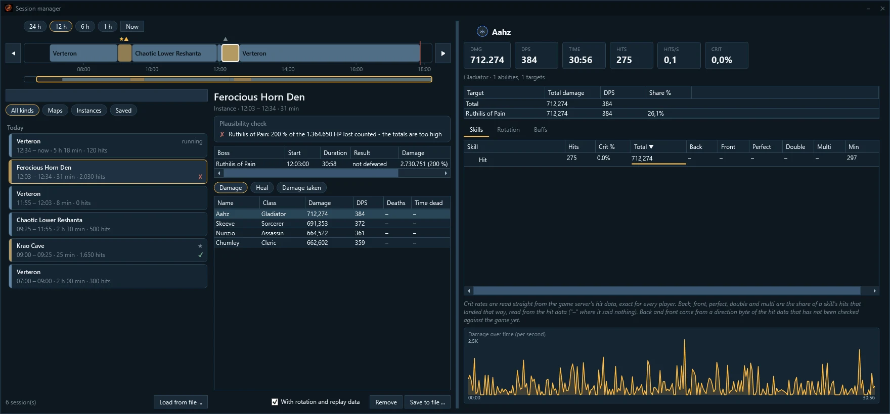
</p>

セッションマネージャーと**戦闘アナライザー**は、動かせる仕切り付きの1つのウィンドウに入っています。左でセッションを選ぶと、右にそのセッションに限ったプレイヤーの詳細(スキル、ローテーション、効果、リプレイマップ)が開きます。プレイヤー一覧の上で**ダメージ・回復・被ダメージ**を切り替えられ、一覧には死亡回数と各プレイヤーが死亡していた時間が表示されます。メーター自体はバックグラウンドで記録を続けます。**ファイルに保存**では、ローテーション・効果・リプレイデータも一緒に保存できます(設定は記憶されるチェックボックス。ファイルは何倍にも大きくなり、5分のボス戦で約0.5〜5MB)。読み込んだファイルでもそれらが表示されます。ウィンドウは位置と仕切りの位置を記憶します。

## 使い方

メーターが起動するとすぐに記録が始まります。**一時停止は破棄**であり、保留ではありません。一時停止中の
イベントは完全にスキップされるため、再開しても参加しなかった戦闘が再生されることはありません。

- **コピー**は、チャットにそのまま貼れる1行のランキング（`Name 1.234.567 (890), …`）をクリップボードにコピーします。**すべてコピー**は
  Discordのマークダウン表を作成します。
- 外観は **設定 → インターフェース** で設定します。テーマ（ダーク/ライト）、フォントサイズ、言語、オーバーレイの外観と
  透明度、Windows起動時の自動起動などです。
- 設定はクラッシュしても失われません。設定ファイルは一度にまとめて書き込まれ、前回の起動時のコピーがその隣に保存されます。ファイルが破損した場合はそのコピーが復元されます（破損したファイルは隣に残ります）。**設定 → 一般 → すべての設定を初期値に戻す**は2回確認され、30秒間は元に戻せます。アップロードとプライバシーの選択、更新チェック、キャラクターはそのまま残ります。

<p align="center">
  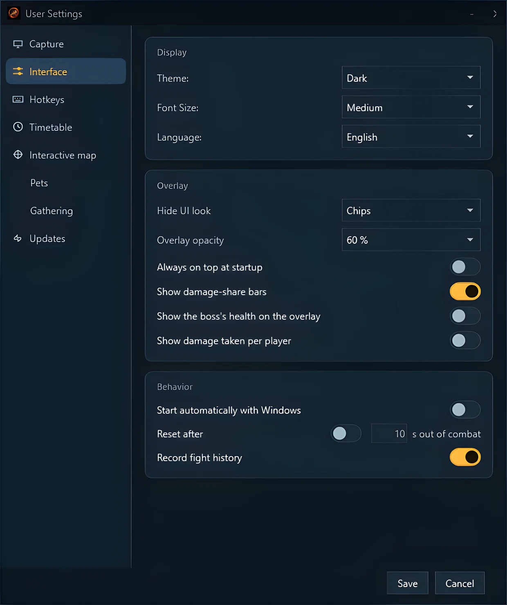
  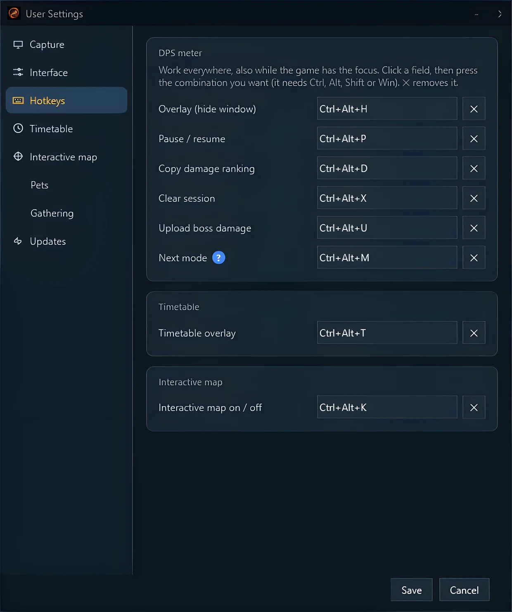
</p>

## ホットキー

システム全体で有効で、ゲームにフォーカスがあるときも動作します。**設定 → ホットキー** でフィールドをクリックし、
希望の組み合わせを押します（Ctrl、Alt、Shift、Win のいずれかが必要です）。**×** で削除できます。ホットキーはチャットコマンドの代わりです。
Aion 2 のチャットはネットワークストリームから読み取れないため、チャットコマンドは使えません。

| デフォルト | アクション |
|---|---|
| **Ctrl+Alt+H** | オーバーレイ（ウィンドウを隠してチップを表示） |
| **Ctrl+Alt+P** | 一時停止 / 再開 |
| **Ctrl+Alt+D** | ダメージランキングをコピー |
| **Ctrl+Alt+Shift+X** | セッションをクリア |
| **Ctrl+Alt+U** | ボスのダメージをアップロード |
| **Ctrl+Alt+M** | 次のモード（5つのビュー） |
| **Ctrl+Alt+T** | タイムテーブルオーバーレイ |
| **Ctrl+Alt+K** | インタラクティブマップ オン / オフ |
| **Ctrl+Alt+E** / **Ctrl+Alt+G** | ペット / 採集物の画面端矢印 |
| **Ctrl+Alt+B** | ワールドボスオーバーレイ |
| **Ctrl+Alt+N** | ネットワークオーバーレイ |
| **Ctrl+Alt+C** | 戦闘オーバーレイ |
| **Ctrl+Alt+L** | ルートオーバーレイ |
| **Ctrl+Alt+J** | このメニュー中もオーバーレイを表示 |
| **Ctrl+Alt+O** | ホットキーオーバーレイ（ホットキーの一覧を表示する移動可能なウィンドウ） |
| **Ctrl+Alt+A** | すべてのオーバーレイ オン / オフ |

## アップロード

- **ボス戦**は、アップロードをクリックしたとき（ツールバーのボタン、セッションメニュー、または **Ctrl+Alt+U**）にアップロードされます。
  ボス、参加したプレイヤー、ダメージ、回復、被ダメージ、スキルが対象です。ゲームが通知し、かつカタログに
  登録されているボスのみ受け付けられます。自動アップロードも利用できますが、**デフォルトではオフ**です。
- **自分のキャラクタープロフィール**（名前、クラス、レベル、装備、スキル、デーヴァニオン、レギオン、サーバー、陣営）は、ログインの数秒後に
  自動でアップロードでき、ウェブサイトで見つけてもらえるようになります。これは
  **デフォルトではオフ**です。**設定**でオンにしてください。
- アップロードしなければ、何もPCの外に出ません。

## 更新

メーターは自動で更新されます。起動時と実行中は5分ごとにGitHubに新しいリリースがあるか確認し、
バックグラウンドでダウンロードして、次回の起動時に入れ替えます。インストーラーもUACの
確認も不要です。アップデートの準備ができると、ステータス行に緑色の表示が現れ（透明な
オーバーレイにはバッジが表示されます）、クリックするとすぐに再起動できます。**アプリ → 更新を確認**でも、必要なときに同じことができます。
古いバージョンは、後継バージョンのリリース後72時間はアップロードを続けられますが、その後は更新が必要です。

確認は1つのURLを読み取るだけで、リクエスト自体以外は何も送信しません。

```
https://api.github.com/repos/SkeeveAN/Aion-DPS-Meter/releases
```

**設定 → 更新** でオフにできます。オフの場合でも、メニュー項目は引き続き使えます。

## 言語

英語、ドイツ語、フランス語、スペイン語、ロシア語、中国語（簡体字と繁体字）、ポルトガル語（ブラジル）、
日本語、韓国語に対応しています。**設定 → インターフェース → 言語** で設定します。このREADMEは次の言語でも
読めます: [Deutsch](README.de.md)、[Español](README.es.md)、[Français](README.fr.md)、[Русский](README.ru.md)、
[中文](README.zh.md)、[繁體中文](README.zh-TW.md)、[Português (Brasil)](README.pt.md)、
[日本語](README.ja.md)、[한국어](README.ko.md)。

## ソースからのビルド

```
cd Client
dotnet build
dotnet run -- selftest                              # self-checks (protocol, capture, decoding, ...)
dotnet run -- aion2-record <out.jsonl>              # record the game's traffic ("stop" ends it)
dotnet run -- aion2-replay <file.jsonl>             # replay a recording through the real decoder
dotnet run -- aion2-upload-dryrun <file.jsonl>      # build the uploads of a recording, send nothing
```

Windows専用です（WPF）。`Tools/aion2-dat` はゲームのテキストテーブル（8言語の名称）を読み取ります。詳しくはそのREADMEを参照してください。

## サーバールールについて

このメーターは、ゲーム自身のネットワーク通信をパッシブに観測するだけです。それでも、サードパーティ製ツールについては
パブリッシャーが独自のルールを定めています。使用する前にゲームの利用規約を確認することをおすすめします。

## 免責事項とライセンス

Aion 2 および関連するすべての名称、テキスト、アートワークはNCSOFTの所有物です。本プロジェクトはNCSOFTと提携しておらず、NCSOFTによる承認も関連もありません。ゲームコンテンツの権利は所有者に帰属します。ソースコードは [MIT License](LICENSE) の下で公開されています。このライセンスの対象はコードのみで、ゲームコンテンツは含まれません。
